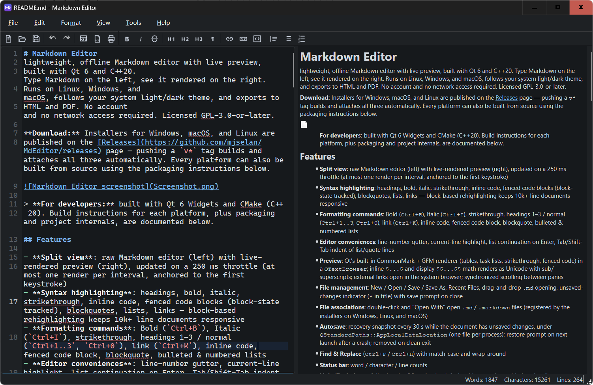

# Markdown Editor

A lightweight, offline Markdown editor with live preview, built with Qt 6 Widgets and CMake (C++20). Type Markdown on the left, see it rendered on the right. Runs natively on Windows, macOS, and Linux, follows your system light/dark theme, and exports to HTML and PDF. No account, telemetry, or network connection required.

Licensed under [GPL-3.0-or-later](LICENSE.md).

**Download:** Pre-built installers for Windows, macOS, and Linux are published on the [Releases](https://github.com/mjselan/MdEditor/releases) page. Every platform can also be built and packaged from source using the instructions below.



---

## Features

- **Split View with Live Preview:** Raw Markdown editor on the left and rendered preview on the right. Live rendering is throttled to 250 ms so typing remains responsive even on large documents.
- **Syntax Highlighting:** Headings, bold, italic, strikethrough, inline code, fenced code blocks (block-state tracked), blockquotes, lists, and links. Block-based incremental re-highlighting keeps 10,000+ line files fast.
- **Formatting Commands & Shortcuts:**
  - **Text:** Bold (`Ctrl+B`), Italic (`Ctrl+I`), Strikethrough (`Ctrl+Shift+K`)
  - **Headings:** Heading 1–3 (`Ctrl+1` .. `Ctrl+3`), Normal text (`Ctrl+0`)
  - **Elements:** Link (`Ctrl+K`), Inline Code (`Ctrl+Shift+C`), Fenced Code Block (`Ctrl+Shift+B`), Blockquote (`Ctrl+Shift+Q`)
  - **Lists:** Bulleted List (`Ctrl+Shift+U`), Numbered List (`Ctrl+Shift+N`)
- **Editor Conveniences:** Line-number gutter, active line highlighting, automatic list continuation on Enter, and multi-line Tab / Shift-Tab indent/unindent.
- **GFM & Math Preview:** Qt's built-in CommonMark + GFM engine renders tables, task lists, and strikethrough. Inline (`$...$`) and display (`$$...$$`) LaTeX math formulas are converted to clean Unicode and sub/superscripts. Synchronized vertical scrolling connects the editor and preview.
- **File Management & Associations:**
  - Standard New, Open, Save, Save As, and Recent Files menu.
  - Drag-and-drop `.md` file opening.
  - Native file association support: double-clicking or right-clicking `.md` / `.markdown` files ("Open with...") opens them directly in the editor across Windows, macOS, and Linux.
  - Unsaved modifications indicator (`*` in title bar) with safety prompts before closing or opening new documents.
- **Crash Recovery & Autosave:** Silently saves a recovery snapshot every 30 seconds for modified documents to `AppLocalDataLocation`. On startup after an unexpected crash or termination, prompts to restore unsaved work. Snapshots are cleaned up automatically on normal exit.
- **Find & Replace:** Search bar (`Ctrl+F`) and replace bar (`Ctrl+H`) with real-time match counting, case-matching toggle, and wrap-around searching.
- **Export & Print:** One-click export to HTML and PDF, plus system printing with high-contrast stylesheets for dark-mode sessions.
- **Outline Panel (`Ctrl+Shift+O`):** Collapsible sidebar listing document headings with click-to-jump navigation and active heading tracking as you scroll.
- **Image Paste:** Pasting an image from the clipboard automatically creates an `assets/` subfolder adjacent to the document, saves the PNG, and inserts the relative Markdown link (``).
- **Themes & UI Styling:** Follows system Light/Dark appearance automatically, with manual overrides in the View menu. Custom multi-resolution toolbar icons are drawn cleanly in code for sharp rendering on high-DPI displays.
- **Optional Spell Check:** Automatically enabled if KDE Frameworks 6 Sonnet (`KF6Sonnet`) is discovered at configure time. Includes misspelled word squiggles, context-menu suggestions, and personal dictionary management.

---

## Dependencies

### Core Requirements
- **C++20 compiler:**
  - Windows: Visual Studio 2026 (v18) or Visual Studio 2022 (v17)
  - Linux: GCC 13+ or Clang 16+
  - macOS: Apple Clang 15+ / Xcode 15+
- **CMake:** 3.21 or newer
- **Build system:** Ninja (recommended) or platform make
- **Qt 6.5+** (tested with Qt 6.11):
  - `Qt6::Core`, `Qt6::Gui`, `Qt6::Widgets`, `Qt6::PrintSupport`
  - `Qt6::Test` (for unit tests)

### Optional Dependencies
- **KF6Sonnet (KDE Frameworks 6):** Enables spell checking (`SonnetCore` + `SonnetUi`). If omitted, spell checking is cleanly compiled out without error.
- **Qt Installer Framework 4.x:** Required only for generating offline installers (`binarycreator`).

---

## Building from Source

This project uses standard `CMakePresets.json` presets (`debug` and `release`).

### Linux
```bash
# Ubuntu / Debian dependencies
sudo apt install qt6-base-dev cmake ninja-build

# Build and run
cmake --preset debug
cmake --build --preset debug
ctest --preset debug
./build/debug/markdowneditor

# Using a standalone Qt installation (e.g. Qt 6.11):
QT_DIR=~/Qt/6.11.1/gcc_64 cmake --preset debug
cmake --build --preset debug
Windows (MSVC)
From an elevated or developer terminal:
code
Bat
:: Initialize Visual Studio 2026 (v18) environment
call "C:\Program Files\Microsoft Visual Studio\18\Community\VC\Auxiliary\Build\vcvars64.bat"

:: Set Qt 6 and Ninja paths
set QT_DIR=C:\Qt\6.11.1\msvc2022_64
set PATH=C:\Qt\Tools\Ninja;%PATH%

:: Configure, build, and test
cmake --preset debug
cmake --build --preset debug
ctest --preset debug
build\debug\markdowneditor.exe
Tip: You can also run tools\windows\devcmd.bat from the repository root. It automatically locates your Visual Studio installation via vswhere.exe and configures the environment.
macOS
code
Bash
# Homebrew dependencies
brew install qt cmake ninja

# Configure, build, and test
QT_DIR="$(brew --prefix qt)" cmake --preset debug
cmake --build --preset debug
ctest --preset debug
./build/debug/MarkdownEditor.app/Contents/MacOS/MarkdownEditor
Packaging & Installation
Installers for each platform are built using Qt Installer Framework 4.x (plus windeployqt on Windows and macdeployqt on macOS). Version numbers are synchronized automatically from CMakeLists.txt via Installer/sync-versions.cmake.
Windows
Run the deployment and installer packaging scripts from the repository root:
code
Bat
tools\windows\devcmd.bat Installer\Windows\windeploy.bat
tools\windows\devcmd.bat Installer\Windows\make-installer.bat
This produces Installer\Windows\MarkdownEditor-<version>-offline.exe.
GUI Installation: Run the installer and follow the wizard. The target directory defaults to C:\Program Files\MarkdownEditor.
Existing Installations & Upgrades: When running the installer over an existing installation in the same folder, the installer prompts to confirm the replacement and cleanly uninstalls previous binaries and registry keys before writing the update.
Silent / Unattended Install:
code
Bat
Installer\Windows\MarkdownEditor-<version>-offline.exe install --default-answer --confirm-command TargetDir=C:/path/to/install
Uninstallation: Run maintenancetool.exe from the Start Menu shortcut or the installation folder, or uninstall via Windows Settings 
→
→
 Installed Apps.
macOS
Run the deployment and DMG packaging scripts:
code
Bash
./Installer/MacOS/macdeploy.sh
./Installer/MacOS/make-installer.sh
This bundles the Qt runtime into MarkdownEditor.app and produces Installer/MacOS/MarkdownEditor-<version>-installer.dmg.
Universal (Intel + Apple Silicon) build:
code
Bash
MARKDOWNEDITOR_PRESET=macos-universal ./Installer/MacOS/macdeploy.sh
./Installer/MacOS/make-installer.sh
Linux
Run the staging script (bundles dependencies via ldd and patchelf) and build the installer:
code
Bash
QT_DIR=$HOME/Qt/6.11.1/gcc_64 ./Installer/Linux/linuxdeploy.sh
./Installer/Linux/make-installer.sh
This produces Installer/Linux/MarkdownEditor-<version>-installer.run.
Continuous Integration & Releases
CI (.github/workflows/ci.yml): Automatically compiles and runs unit tests on Windows, Linux, and macOS on every push and pull request.
Releases (.github/workflows/release.yml): Pushing a v* tag (e.g. v1.0.5) triggers automated release packaging for all three platforms and attaches the generated installers directly to the matching GitHub Release.
See docs/packaging.md for detailed staging manifests and distribution internals.
code
Code
38.2s
Model 11:00 PM
ThinkingThoughts
Expand to view model thoughts

chevron_right
Here is the complete, full content for README.md. You can copy and paste the entire block directly into the file.
code
Markdown
# Markdown Editor

A lightweight, offline Markdown editor with live preview, built with Qt 6 Widgets and CMake (C++20). Type Markdown on the left, see it rendered on the right. Runs natively on Windows, macOS, and Linux, follows your system light/dark theme, and exports to HTML and PDF. No account, telemetry, or network connection required.

Licensed under [GPL-3.0-or-later](LICENSE.md).

**Download:** Pre-built installers for Windows, macOS, and Linux are published on the [Releases](https://github.com/mjselan/MdEditor/releases) page. Every platform can also be built and packaged from source using the instructions below.


> **For developers:** Built with Qt 6 Widgets and CMake (C++20). Build instructions for each platform, packaging scripts, and project layout are documented below.

---

## Features

- **Split View with Live Preview:** Raw Markdown editor on the left with live-rendered preview on the right. Rendering is throttled to 250 ms (at most one render per interval, anchored to the first keystroke in a burst) so typing stays responsive on 10,000+ line documents.
- **Syntax Highlighting:** Headings, bold, italic, strikethrough, inline code, fenced code blocks (tracked with block states), blockquotes, lists, and links. Block-based incremental re-highlighting ensures fast performance.
- **Formatting Commands & Shortcuts:**
  - **Text:** Bold (`Ctrl+B`), Italic (`Ctrl+I`), Strikethrough (`Ctrl+Shift+K`)
  - **Headings:** Heading 1–3 (`Ctrl+1` .. `Ctrl+3`), Normal text (`Ctrl+0`)
  - **Elements:** Link (`Ctrl+K`), Inline Code (`Ctrl+Shift+C`), Fenced Code Block (`Ctrl+Shift+B`), Blockquote (`Ctrl+Shift+Q`)
  - **Lists:** Bulleted List (`Ctrl+Shift+U`), Numbered List (`Ctrl+Shift+N`)
- **Editor Conveniences:** Line-number gutter, current-line highlight, automatic list continuation on Enter, and multi-line Tab / Shift-Tab indent and unindent of list and quote blocks.
- **GFM & Math Preview:** Qt's built-in CommonMark + GFM engine renders tables, task lists, strikethrough, and fenced code. Inline (`$...$`) and display (`$$...$$`) LaTeX math formulas are converted to clean Unicode with sub/superscripts. Synchronized vertical scrolling connects the editor and preview.
- **File Management:**
  - Standard New, Open, Save, Save As, and Recent Files menu.
  - Drag-and-drop `.md` file opening.
  - Native file associations: double-clicking or selecting "Open with..." opens `.md` and `.markdown` files directly in the editor across Windows, macOS, and Linux.
  - Unsaved-changes indicator (`*` in title bar) with safety confirmation before closing or opening another file.
- **Crash Recovery & Autosave:** Saves a recovery snapshot every 30 seconds for modified documents under `QStandardPaths::AppLocalDataLocation` (one per process). Prompts to restore unsaved work on launch after a crash; clean exit removes the snapshot.
- **Find & Replace:** Search bar (`Ctrl+F`) and replace bar (`Ctrl+H`) with real-time match counting, case-sensitive matching, and document wrap-around.
- **Status Bar:** Live word, character, and line counts computed via a single-pass non-allocating scanner.
- **Themes & UI Styling:** Follows system Light/Dark appearance automatically, with manual overrides in the View menu (persisted via `QSettings`).
- **Painted Vector Icons:** Toolbars and brand mark icons are rendered directly in code (`src/appicons.*`) across multiple DPI buckets—no asset files or icon font dependencies required. Icons automatically adapt their accent colors when switching between light and dark themes.
- **Export & Print:** One-click export to HTML and PDF, plus system printing using a light-mode safe stylesheet so dark-mode sessions produce crisp black-on-white output.
- **Outline Panel (`Ctrl+Shift+O`):** Collapsible sidebar listing document headings with click-to-jump navigation and active heading tracking as you scroll.
- **Image Paste:** Pasting an image from the clipboard automatically creates an `assets/` subfolder adjacent to the saved document, writes the PNG, and inserts the relative Markdown image tag (``).
- **Optional Spell Check:** Enabled automatically when KDE Frameworks 6 Sonnet is found at configure time. Highlights misspelled words with a theme-aware squiggle, provides suggestions and personal dictionary actions via right-click, and ignores version numbers and hashes.

> **Renderer note:** The preview uses Qt's built-in Markdown support; fenced code blocks are rendered as plain code blocks (no per-language token coloring). If GitHub-faithful rendering with JS syntax highlighting is ever needed, a `QWebEngineView` variant with a bundled renderer in a Qt resource can be introduced.

---

## Dependencies

### Core Requirements
- **C++20 compiler:**
  - Windows: Visual Studio 2026 (v18) or Visual Studio 2022 (v17)
  - Linux: GCC 13+ or Clang 16+
  - macOS: Apple Clang 15+ / Xcode 15+
- **CMake:** 3.21 or newer
- **Build system:** Ninja (recommended) or platform make
- **Qt 6.5+** (tested with Qt 6.11):
  - `Qt6::Core`, `Qt6::Gui`, `Qt6::Widgets`, `Qt6::PrintSupport`
  - `Qt6::Test` (for unit tests)

### Optional Dependencies
- **KF6Sonnet (KDE Frameworks 6):** Enables spell checking (`SonnetCore` + `SonnetUi`). If absent, the build succeeds with spell checking cleanly disabled.
  - *Dictionaries:* Sonnet uses system Hunspell dictionaries on Linux (`/usr/share/hunspell`), or bundled dictionaries staged under `bin/data/hunspell/` on Windows and macOS.
- **Qt Installer Framework 4.x:** Required only for generating offline installers (`binarycreator`).

---

## Building from Source

This project uses standard `CMakePresets.json` presets (`debug` and `release`).

### Linux
```bash
# Ubuntu / Debian dependencies
sudo apt install qt6-base-dev cmake ninja-build

# Build and run
cmake --preset debug
cmake --build --preset debug
ctest --preset debug
./build/debug/markdowneditor

# Using a standalone Qt installation (e.g. Qt 6.11):
QT_DIR=~/Qt/6.11.1/gcc_64 cmake --preset debug
cmake --build --preset debug
Windows (MSVC)
code
Bat
:: Initialize Visual Studio 2026 (v18) environment
call "C:\Program Files\Microsoft Visual Studio\18\Community\VC\Auxiliary\Build\vcvars64.bat"

:: Set Qt 6 and Ninja paths
set QT_DIR=C:\Qt\6.11.1\msvc2022_64
set PATH=C:\Qt\Tools\Ninja;%PATH%

:: Configure, build, and test
cmake --preset debug
cmake --build --preset debug
ctest --preset debug
build\debug\markdowneditor.exe
Tip: You can also run tools\windows\devcmd.bat from the repository root. It automatically locates your Visual Studio installation via vswhere.exe and configures the environment.
macOS
code
Bash
# Homebrew dependencies
brew install qt cmake ninja

# Configure, build, and test
QT_DIR="$(brew --prefix qt)" cmake --preset debug
cmake --build --preset debug
ctest --preset debug
./build/debug/MarkdownEditor.app/Contents/MacOS/MarkdownEditor
Packaging & Installation
Installers are built using Qt Installer Framework 4.x (plus windeployqt on Windows and macdeployqt on macOS). Version numbers are synchronized automatically from CMakeLists.txt via Installer/sync-versions.cmake.
Windows
Run the deployment and installer scripts from the repository root:
code
Bat
tools\windows\devcmd.bat Installer\Windows\windeploy.bat
tools\windows\devcmd.bat Installer\Windows\make-installer.bat
Produces Installer\Windows\MarkdownEditor-<version>-offline.exe.
GUI Installation: Run the installer and follow the wizard. The target directory defaults to C:\Program Files\MarkdownEditor.
Upgrades & Reinstalls: When installing over an existing version, the installer detects the existing installation, prompts to confirm, and uninstalls the previous version cleanly before staging the update.
Silent Install:
code
Bat
Installer\Windows\MarkdownEditor-<version>-offline.exe install --default-answer --confirm-command TargetDir=C:/path/to/install
Shell Associations: Registers .md and .markdown under Windows "Open with..." and Recommended Programs via RegisterFileType.
Uninstallation: Run maintenancetool.exe from the Start Menu shortcut or install folder, or uninstall through Windows Settings 
→
→
 Installed Apps.
macOS
Run the deployment and DMG packaging scripts:
code
Bash
./Installer/MacOS/macdeploy.sh
./Installer/MacOS/make-installer.sh
Produces Installer/MacOS/MarkdownEditor-<version>-installer.dmg.
Universal (Intel + Apple Silicon) build:
code
Bash
MARKDOWNEDITOR_PRESET=macos-universal ./Installer/MacOS/macdeploy.sh
./Installer/MacOS/make-installer.sh
Linux
Run the staging script (bundles dependencies via ldd and patchelf) and build the installer:
code
Bash
QT_DIR=$HOME/Qt/6.11.1/gcc_64 ./Installer/Linux/linuxdeploy.sh
./Installer/Linux/make-installer.sh
Produces Installer/Linux/MarkdownEditor-<version>-installer.run.
Project Layout
code
Text
├── src/                  # Application source code (C++20 / Qt 6 Widgets)
├── resources/            # Windows icon resource (app.ico)
├── tests/                # Unit tests executed via CTest
├── tools/                # Development environment scripts (devcmd.bat, Sonnet provisioning)
├── Installer/            # Qt Installer Framework configurations per platform
│   ├── Windows/          # Windows IFW package metadata and build scripts
│   ├── MacOS/            # macOS macdeployqt and DMG packaging scripts
│   └── Linux/            # Linux runtime bundling and packaging scripts
└── docs/                 # Packaging manifests and internal documentation
Continuous Integration & Releases
CI (.github/workflows/ci.yml): Compiles and runs tests on Windows, Linux, and macOS on every push and pull request.
Releases (.github/workflows/release.yml): Pushing a v* tag (e.g. v1.0.5) builds and attaches signed installers for all three platforms to the matching GitHub Release.
For staging manifests and packaging internals, see docs/packaging.md.
